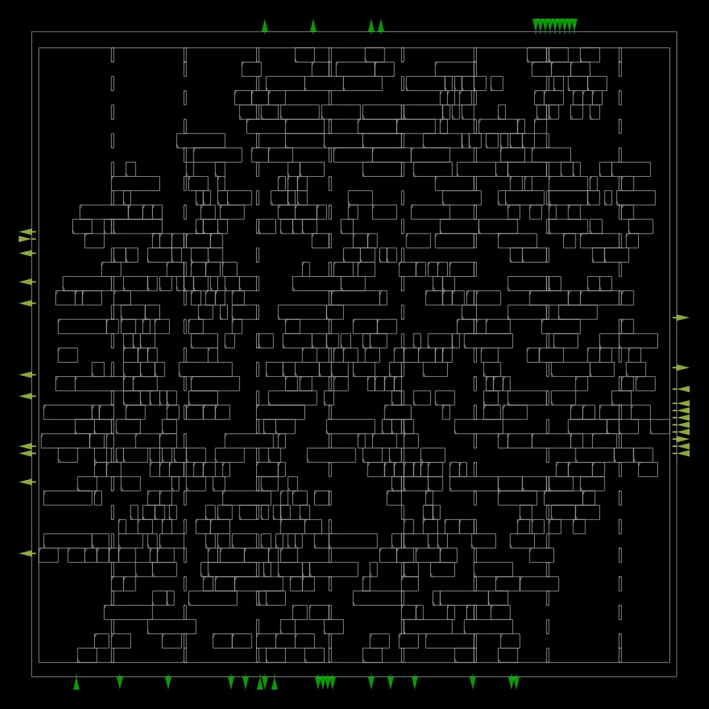
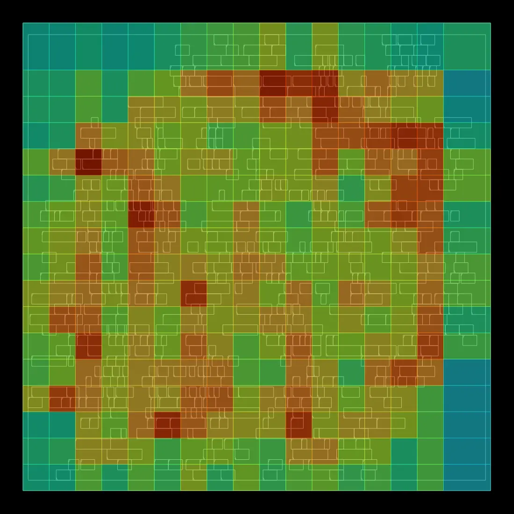
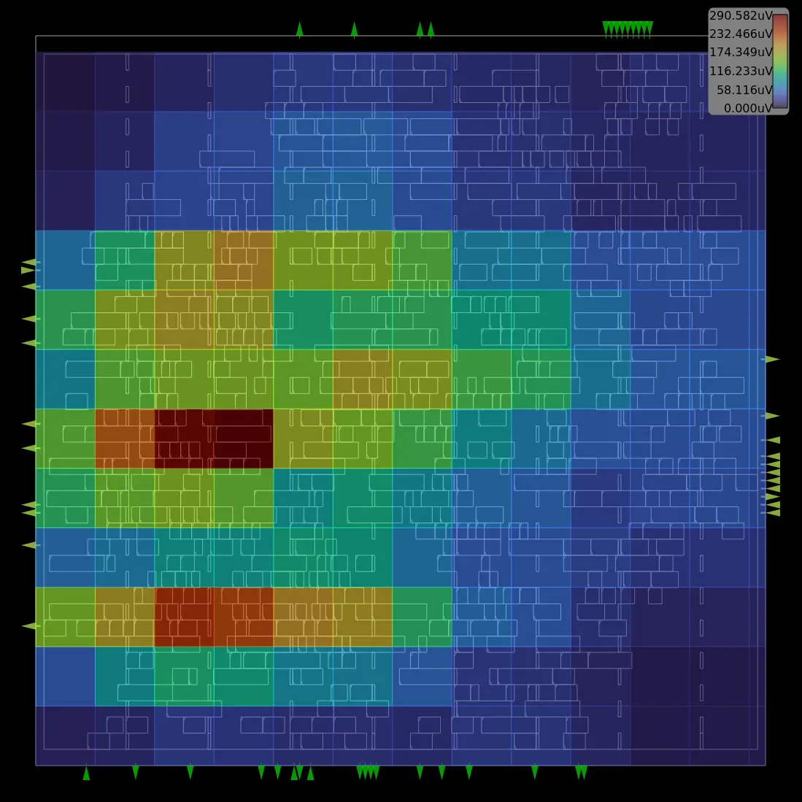
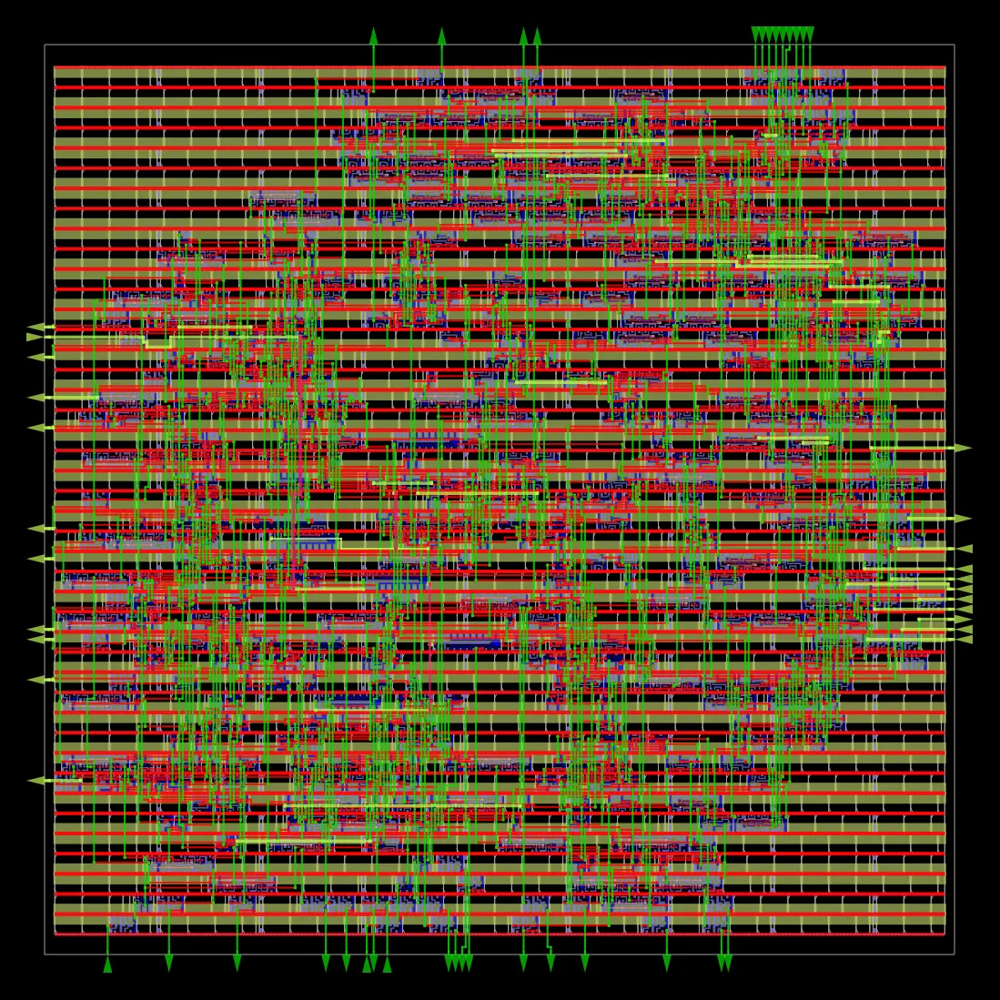
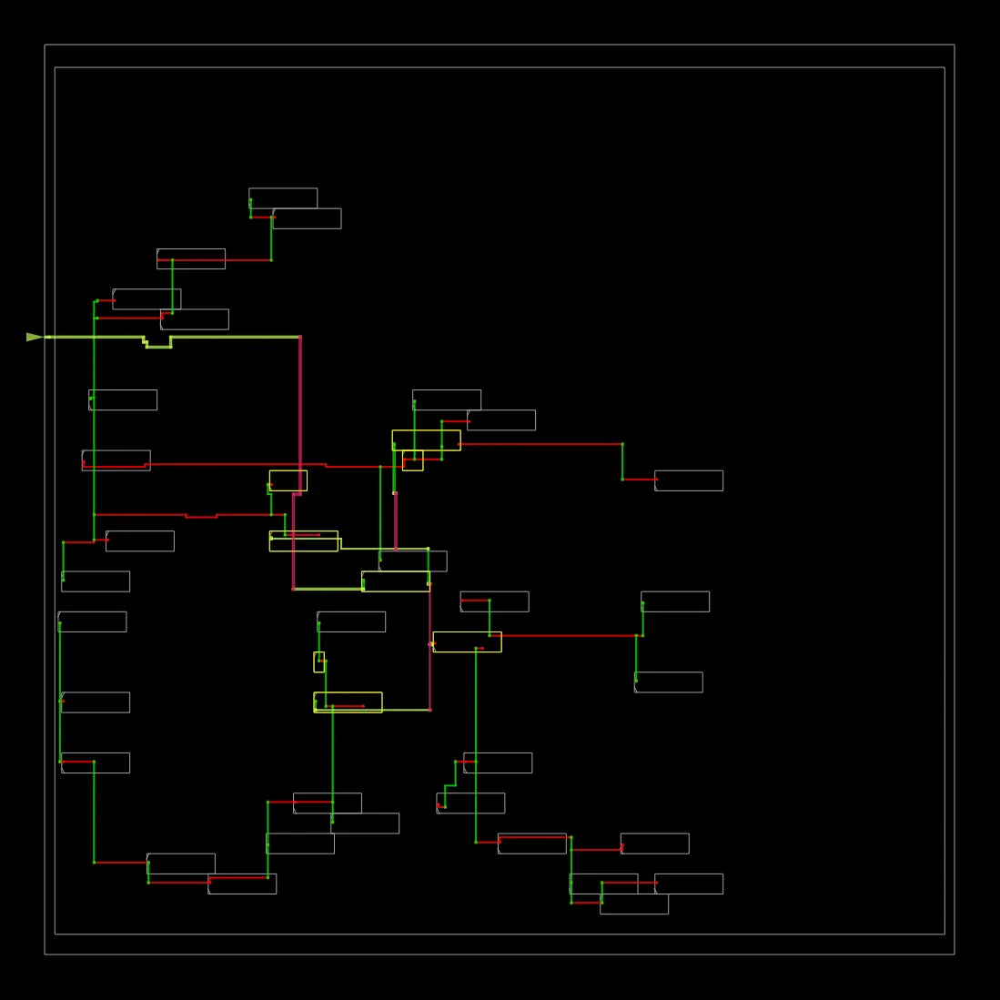
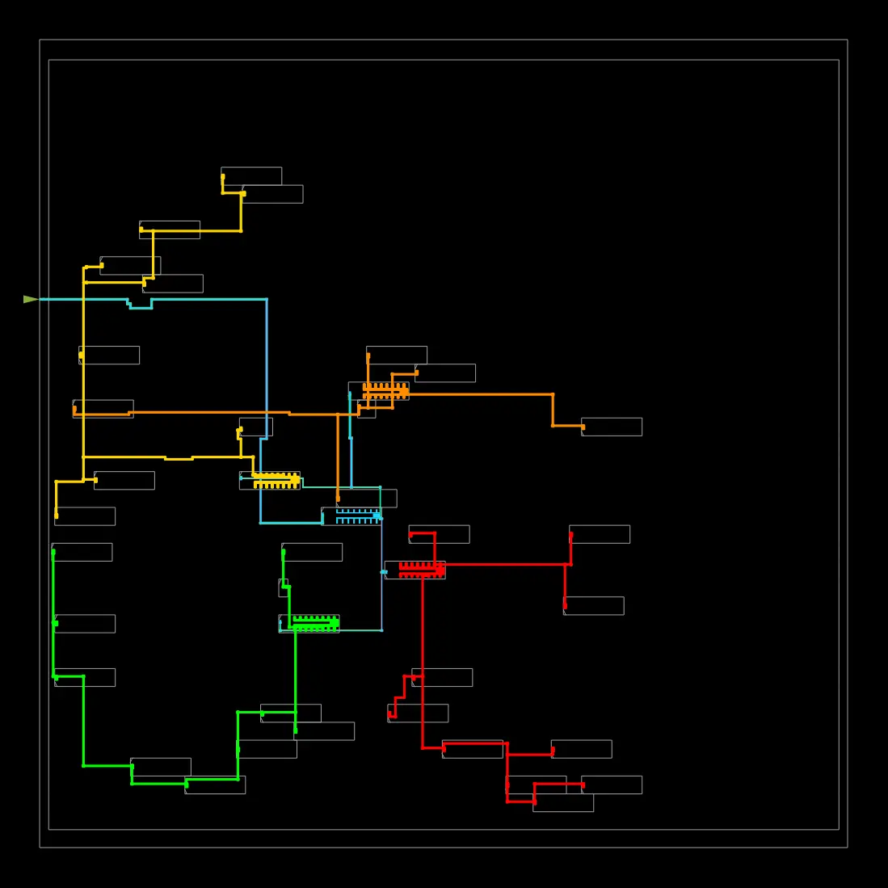
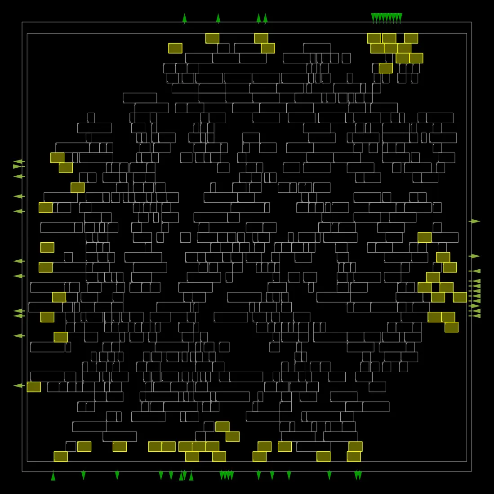
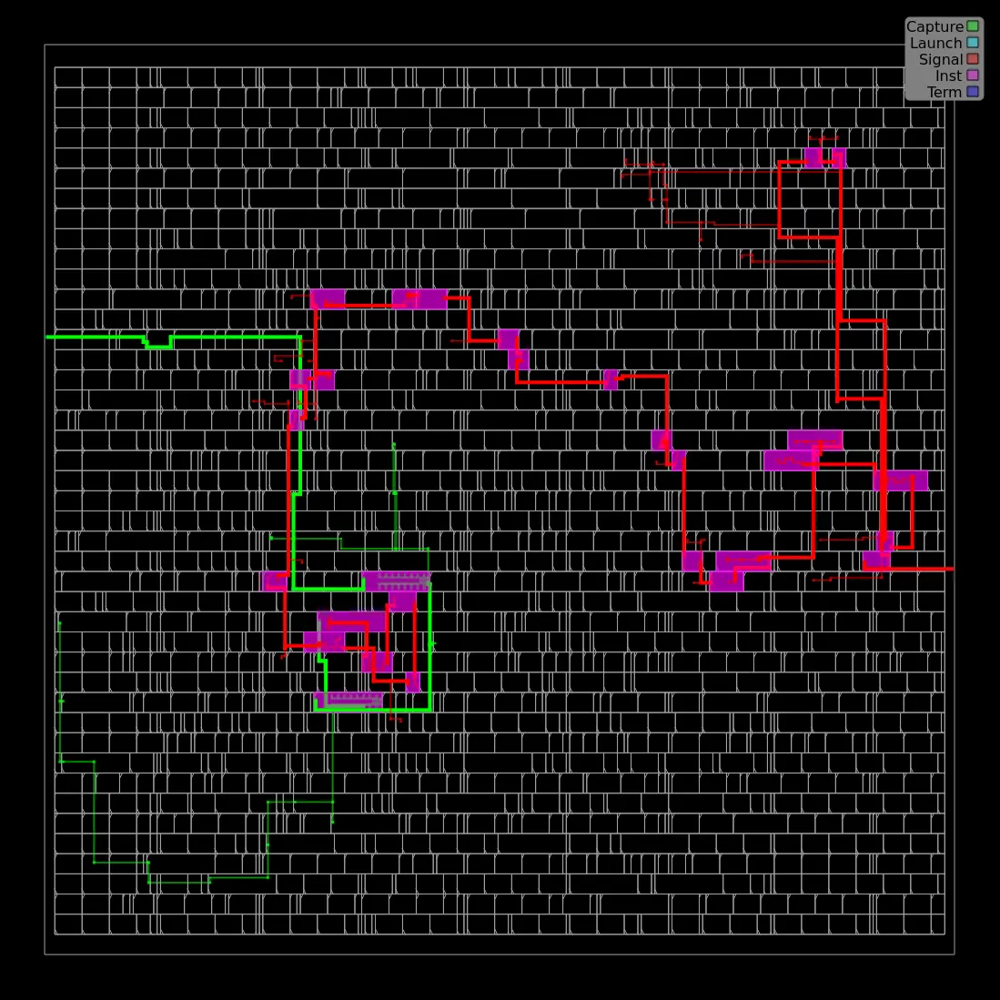
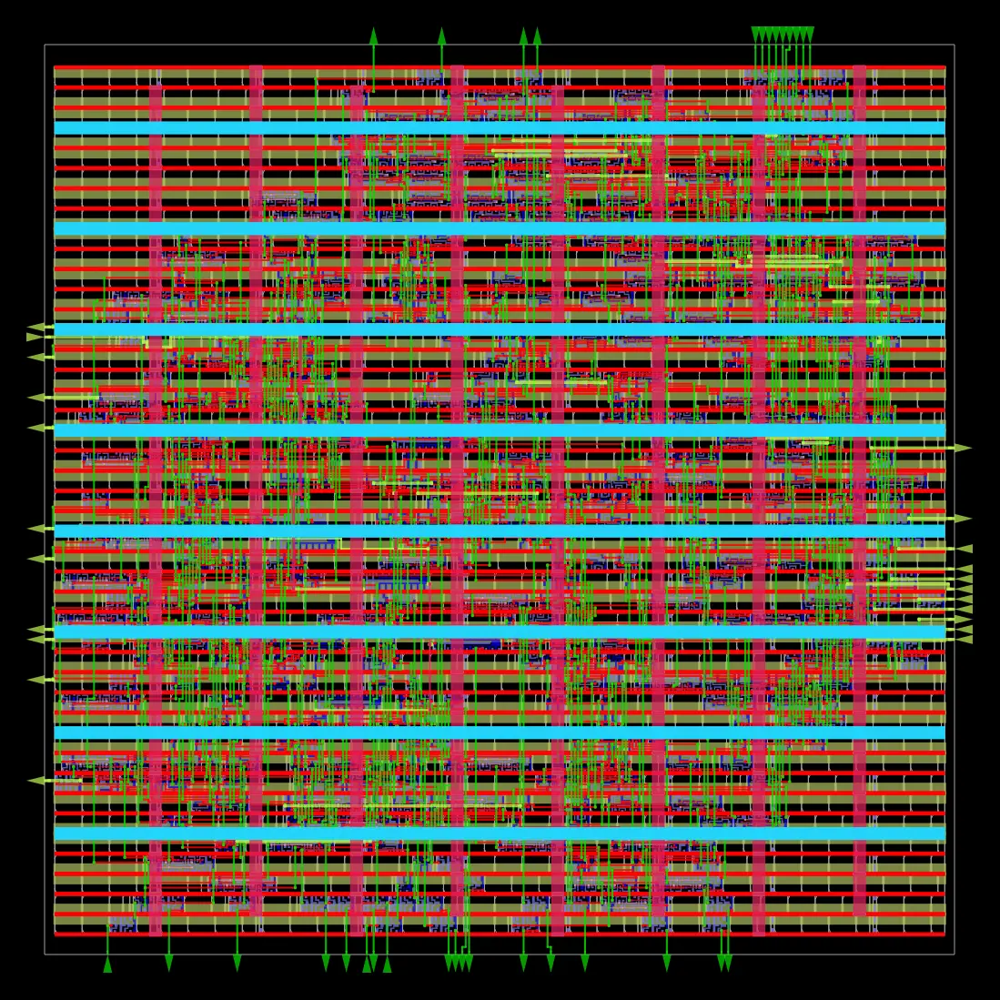
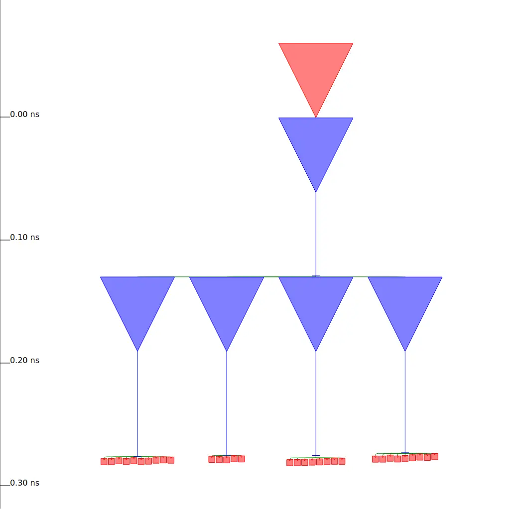

# Layer-Wise Mixed-Precision Neural Network Accelerator

<p align="center">
  <strong>RTL design · Functional verification · Synthesis · RTL-to-GDS physical design</strong><br>
  SkyWater SKY130 HD · SystemVerilog · Icarus Verilog · Yosys · OpenROAD
</p>

> **Scope and status:** The current implemented and verified design is a signed INT4/INT8 mixed-precision multiply-accumulate (MAC) block. It is an accelerator building block and a starting point for a future layer-wise neural-network accelerator; this repository does not claim to implement a complete neural-network inference engine.

## At a glance

| Item | Result |
|---|---|
| Main RTL block | `mixed_precision_mac` |
| Arithmetic modes | Signed INT4 and signed INT8 |
| Accumulator | 32-bit |
| Functional simulation | **11 checks passed** |
| Physical-design platform | SKY130 HD |
| Final reported worst slack | **+1.16 ns** |
| Reported minimum clock period | **8.84 ns** |
| Reported maximum frequency | **113.10 MHz** |
| Final layout deliverables | GDS, DEF, ODB, SDC, SPEF, routed Verilog |

Timing figures are taken from the supplied OpenROAD `6_finish.rpt` under the checked-in constraint assumptions. They are implementation results for this MAC block and this flow configuration, not a claim about a complete neural-network accelerator.

## Design overview

The block accepts signed 8-bit activation and weight inputs and selects the arithmetic precision using `precision_mode`:

- **INT4 mode (`precision_mode = 0`)**: uses the low four bits of each operand as signed two's-complement values.
- **INT8 mode (`precision_mode = 1`)**: uses the full signed 8-bit operands.
- The product is accumulated into a signed 32-bit accumulator.
- Control inputs include active-low reset, enable, and accumulator clear.

See [`rtl/mixed_precision_mac.sv`](rtl/mixed_precision_mac.sv) for the implementation and [`constraints/timing.sdc`](constraints/timing.sdc) for the timing constraints. The SDC defines a 10 ns clock period with 0.2 ns clock uncertainty, plus input and output delay assumptions.

## Functional verification

The testbench is at [`tb/tb_mixed_precision_mac.sv`](tb/tb_mixed_precision_mac.sv). The recorded simulation log reports **11 passing checks**, including reset, INT4 arithmetic, INT8 signed boundary cases, accumulator clear, and disabled-accumulator hold behavior.

| Test category | Example covered |
|---|---|
| Reset | Accumulator returns to zero |
| INT4 arithmetic | Positive, negative, and minimum signed values |
| INT8 arithmetic | Maximum positive product and negative boundary case |
| Signed corner case | `-128 × -128 = 16384` |
| Control behavior | Clear and hold while disabled |

The saved log is available at [`results/simulation/simulation.log`](results/simulation/simulation.log). A GTKWave-compatible VCD and a waveform screenshot are in [`results/waveforms/`](results/waveforms/).

## RTL-to-GDS physical-design gallery

The following figures are the visualizations generated by the OpenROAD run and stored in `results/physical_design/images/`. They are included as implementation artifacts; interpret each view in the context of the corresponding report and flow stage.

### Final placement



### Routing congestion



### IR-drop visualization



### Final routing



### Clock distribution



### Clock-tree synthesis layout



### Resizer / physical optimization view



### Worst timing path



### Timing-path overview



### Clock-tree synthesis view



## Physical-design results and reports

Final outputs from the completed flow are in [`results/physical_design/final_layout/`](results/physical_design/final_layout/):

- `6_final.gds` — final GDSII layout.
- `6_final.def` — final Design Exchange Format placement/routing representation.
- `6_final.odb` — OpenDB physical-design database.
- `6_final.v` — final routed Verilog netlist.
- `6_final.sdc` — timing constraints associated with the final design.
- `6_final.spef` — extracted parasitic data.

Stage reports are in [`results/physical_design/reports/`](results/physical_design/reports/), including floorplan, placement, resizer, clock-tree synthesis, global routing, final timing, and the detailed-routing DRC report file. The checked-in DRC report is empty; this repository therefore does **not** use that file alone to claim that all sign-off physical verification has passed.

Synthesis statistics and checks are under [`results/synthesis/`](results/synthesis/), and the synthesis log is at [`results/yosys_synthesis.log`](results/yosys_synthesis.log).

## Repository layout

```text
.
├── rtl/                         # SystemVerilog design
├── tb/                          # Functional testbench
├── constraints/                 # SDC timing constraints
├── scripts/                     # Helper scripts
├── model/                       # Reference-model location
├── results/
│   ├── simulation/               # Compile and simulation logs
│   ├── waveforms/                # VCD and waveform screenshot
│   ├── synthesis/                # Synthesis statistics, checks, netlist
│   └── physical_design/
│       ├── images/               # OpenROAD visualizations
│       ├── reports/              # Stage and timing reports
│       └── final_layout/         # GDS, DEF, ODB, SDC, SPEF, Verilog
└── README.md
```

## Reproducing the functional simulation

The recorded simulation was run with Icarus Verilog. From the repository root, the equivalent commands are:

```bash
mkdir -p build
iverilog -g2012 -o build/tb_mixed_precision_mac.vvp \
  rtl/mixed_precision_mac.sv tb/tb_mixed_precision_mac.sv
vvp build/tb_mixed_precision_mac.vvp
```

The expected log ends with:

```text
PASS: all 11 checks completed
```

For synthesis and physical-design reproduction, use a compatible Yosys/OpenROAD-flow setup and the SKY130 HD platform. The final databases and reports in this repository are saved outputs from the recorded run; they are not a substitute for rerunning the flow in a matching environment.

## Tools and technology

- SystemVerilog for RTL and testbench
- Icarus Verilog for functional simulation
- Yosys for synthesis
- OpenROAD flow with the SKY130 HD standard-cell platform for physical design
- GTKWave-compatible VCD for waveform inspection

## Next development steps

1. Add an automated, non-empty regression script and a software reference model.
2. Expand verification with randomized operand/control sequences and assertions for signed INT4 sign extension, accumulation, reset, clear, and enable priority.
3. Compare INT4 and INT8 implementations using consistent area, timing, and power methodology.
4. Integrate multiple MACs into a layer-wise compute datapath and add controller/dataflow, buffering, and a reproducible neural-network inference workload.
5. Validate power-integrity and physical-verification results with the appropriate reports and sign-off checks before making sign-off claims.

## License

No license is currently specified. Add a license file before redistributing this project for reuse.
